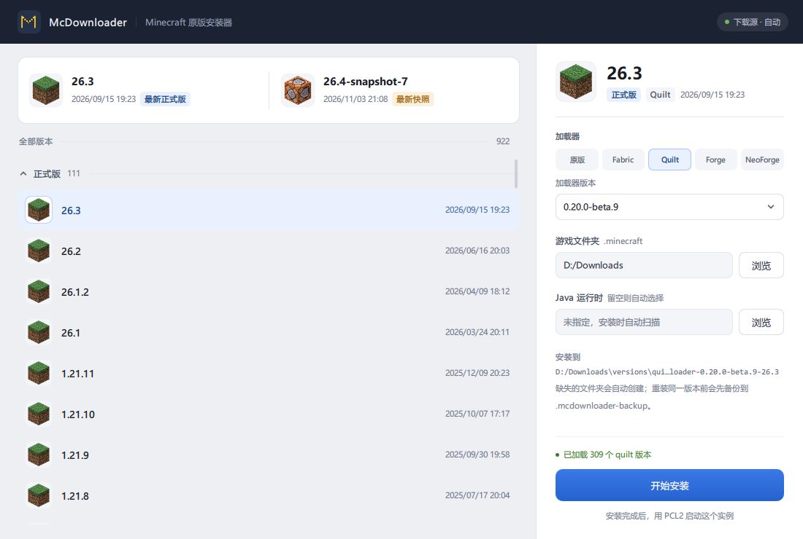

# McDownloader

选版本，选加载器，装完走人。装出来的实例 PCL2 能直接读。



## 能装什么

原版，以及 Fabric、Quilt、Forge、NeoForge 四种加载器。

版本清单从 BMCLAPI 和 Mojang 同时拉，两边合并去重。单个源挂了照样出列表，两个都挂了就用上次的离线缓存。原版的客户端、库、资源、日志配置一次下完，每个文件过一遍 SHA1；单个地址失败会按 1/2/4 秒重试，再换镜像。

Fabric 和 Quilt 直接取 profile，不用跑安装器。Forge 和 NeoForge 得先下 installer 再用 Java 跑一遍。

装完会把 Java 绑到实例上：按常见路径找本机的 JDK，照版本要求挑一个，在 `versions\<实例>\` 下建 `java` 链接，同时写 PCL2 的 `Setup.ini`。这样 PCL2 打开就能看见这个实例，不用手动配。

## 自己编译

暂时没有预编译包，先自己编一份。要 Qt 5.15.2 + MinGW 8.1 64 位，Qt Network 还需要 OpenSSL 1.1.1。

```powershell
powershell -ExecutionPolicy Bypass -File scripts\prepare-openssl.ps1

# 编译 + 部署依赖 + 打包
powershell -ExecutionPolicy Bypass -File scripts\build.ps1 -Deploy -Package
```

环境拿不准就先跑 `scripts\check-env.ps1`，缺什么它会说。

产物两个：`build\release\McDownloader.exe` 和 `dist\McDownloader-win64.zip`。zip 解压到哪都行，双击 exe 就跑。绿色版，配置和日志放在 exe 旁边，不碰注册表。

跑测试：

```powershell
powershell -ExecutionPolicy Bypass -File scripts\run-tests.ps1
```

加 `-Network` 会额外跑真实版本清单和镜像回退，需要联网。

## 用法

1. 左边挑一个 Minecraft 版本
2. 右边挑加载器。原版是默认项，选了别的会多出一个版本下拉
3. 确认 `.minecraft` 目录
4. 点开始安装

Java 那栏留空就行，程序自己扫。同一个版本重复装会先把旧的挪到 `.mcdownloader-backup`，装失败再挪回来。

## 命令行

`tools/installer-cli` 是不带界面的安装入口，脚本批量装的时候用得上。

```powershell
cd tools\installer-cli
mkdir build -Force | Out-Null
cd build
qmake ..\installer-cli.pro
mingw32-make -j4

.\release\installer-cli.exe --mc 1.20.1 --dir D:\game\.minecraft
.\release\installer-cli.exe --mc 1.20.1 --dir ... --loader fabric --loader-version 0.20.1
```

`--loader` 可选 `vanilla` / `fabric` / `quilt` / `forge` / `neoforge`，默认原版。非原版必须带 `--loader-version`，漏了直接报错退出，不会自己猜。

## 目录

| 路径 | 干什么的 |
| --- | --- |
| `src/core` | 路径校验、SHA1、日志、版本模型和分组 |
| `src/download` | 下载队列、镜像回退、JSON 请求 |
| `src/installers` | 安装计划、各加载器、Java 定位 |
| `qml` | 界面，Qt Quick |
| `tests` | QtTest 用例 |
| `tools/installer-cli` | 命令行入口 |

## 边界

只负责装，不负责启动。启动交给 PCL2 或官方启动器。

OptiFine 没做。

镜像上个别文件会 404（比如老的日志配置），程序会退到官方源重试。慢是慢了点，但会下完。
